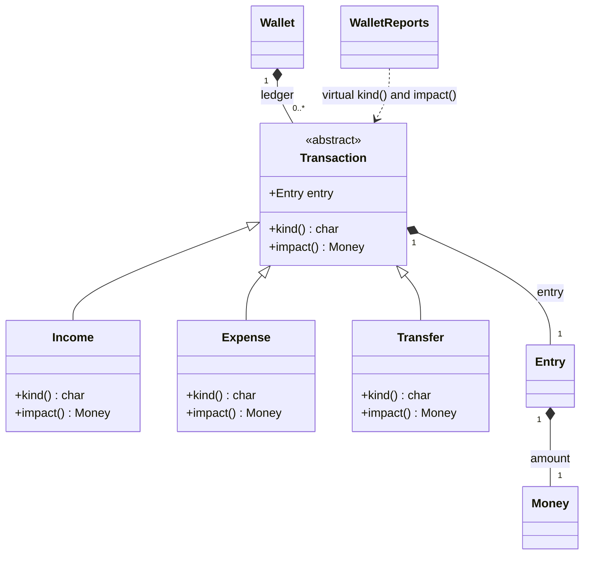

# MoneyMap — terminal expense tracker in C++

MoneyMap is a local, keyboard-driven personal-finance application. It records income, expenses, transfers and split bills, then calculates budgets, savings goals, category summaries and bank-statement insights. Data is kept in CSV files, so the application works offline and can be inspected or backed up easily.

## Features

- Multiple wallet accounts with an opening balance.
- Add income, expenses and transfers; edit or delete expenses.
- Category and payment-method tracking, including Must / Need / Want priorities.
- Split a bill between “Me” and other people; record repayments.
- Monthly and category budgets with utilization warnings.
- Savings goals and contributions.
- Import bank statements from CSV with duplicate detection.
- Dashboard, history, statistics and a full report.
- Calculator-style amount entry (for example `(120 + 80) / 2`).
- Color-coded terminal cards, tables, progress meters and responsive layout.

## Requirements

- Windows Terminal, PowerShell, or a UTF-8 capable terminal.
- A C++20 compiler such as MinGW-w64 `g++` (only needed when rebuilding).

## Run the supplied build

Open this folder in VS Code, open **Terminal → New Terminal**, then run:

```powershell
cd "D:\code\OOP_PROJECT\MoneyMap-OOP"
.\MoneyMap.exe
```

If your folder is elsewhere, use that folder in the `cd` command. Keep the executable in a writable folder because it creates account CSV files and a temporary `wallet.lock` file.

## Build from source

```powershell
g++ -std=c++20 -Wall -Wextra -Wpedantic -static `
  main.cpp application.cpp wallet.cpp bank.cpp reports.cpp `
  -o MoneyMap.exe
.\MoneyMap.exe
```

On a non-Windows shell, replace the final command with `./MoneyMap.exe` (or the name produced by your compiler).

## First use

1. Start the executable and choose or create an account.
2. Enter the owner name and opening balance.
3. Optionally set a monthly budget and savings goal.
4. Use the dashboard shortcuts:

| Key | Action |
|---|---|
| `N` | Add income, expense or transfer |
| `H` | Browse wallet history |
| `E` | Edit or delete an expense |
| `A` | Statistics for a month or all dates |
| `R` | Full financial report |
| `B` | Budgets and category priorities |
| `G` | Savings goals |
| `S` | Split a paid bill / record repayment |
| `I` | Import and analyse a bank CSV |
| `U` | Switch or create an account |
| `P` | Change opening balance |
| `Q` | Save and quit |

Press **Enter** at a screen’s return prompt to go back to the dashboard.

## How the program works

```text
main.cpp
  -> MoneyMapApp::run()
  -> load/select Wallet account
  -> TerminalUI draws dashboard and reads a shortcut
  -> MoneyMapApp routes the shortcut to a workflow
  -> Wallet mutates ledger/budgets/goals/shares/statement
  -> Wallet::save() writes the account CSV
  -> dashboard is rendered again
```

Reports read the wallet without changing it. Bank import reads an external CSV, converts each row to `BankRow`, rejects duplicate keys, and stores the statement rows in the wallet. Manual transactions are stored as polymorphic `Transaction` objects: `Income`, `Expense` and `Transfer`.

## Source map

| File | Main responsibility |
|---|---|
| `main.cpp` | Application entry point; creates `MoneyMapApp` and calls `run()`. |
| `application.hpp/.cpp` | Coordinates accounts, dashboard shortcuts and user workflows. |
| `wallet.hpp/.cpp` | Domain model, `Money`, `Entry`, `Transaction` hierarchy, CSV persistence and wallet-owned data. |
| `reports.hpp/.cpp` | Statistics, dashboard cards and full reports. |
| `bank.hpp/.cpp` | `BankStatementService`: CSV parsing, duplicate checks and payment-mode/merchant summaries. |
| `terminal.hpp` | `TerminalUI`: colors, cards, tables, prompts, meters and responsive terminal layout. |
| `common.hpp` | `InputTools`: validation, parsing, dates and shared prompts. |
| `calculator.hpp` | Expression parser and calculator input workflow. |
| `insights.hpp` | Movement records and reusable trend calculations. |

## OOP concepts used

- **Encapsulation:** `Wallet` controls ledger changes; `Money` hides its internal paise value.
- **Inheritance:** `Income`, `Expense` and `Transfer` derive from abstract `Transaction`.
- **Runtime polymorphism:** `Wallet` stores `unique_ptr<Transaction>` and reports call virtual `kind()` / `impact()` through the base type.
- **Composition:** `MoneyMapApp` owns service objects; `Wallet` owns transactions, goals, shares and bank rows.
- **Operator overloading:** `Money` supports arithmetic and comparisons.
- **STL and RAII:** `vector`, `map`, `unique_ptr`, algorithms and automatic resource cleanup.
- **File handling and exceptions:** CSV persistence/import plus validation using `try`, `catch` and `throw`.

## Connected architecture

This diagram is written directly in Mermaid inside this README, so GitHub renders it with the documentation. Solid arrows show calls or data flow; dotted arrows show supporting dependencies. Ownership is labelled explicitly. The inheritance tree is shown below the workflow.

```mermaid
flowchart TB
    User([User in terminal]) --> Main["main.cpp<br/>main() creates MoneyMapApp"]
    Main --> App["MoneyMapApp · application.hpp / .cpp<br/>run(): session, account selection, action loop"]
    App --> Session["openSession() → accounts() / setup()<br/>Select or create an account"]
    Session --> Load["Wallet::load()<br/>Restore saved account into RAM"]
    Load --> Dashboard["WalletReports::dashboard(w)<br/>Balance, budget, goals, recent activity"]
    Dashboard --> Action{"Dashboard shortcut"}

    subgraph Features["Application workflows · application.cpp"]
      Add["N · addManual(w)<br/>Expense / Income / Transfer"]
      History["H · records(w)<br/>Read and filter ledger"]
      Edit["E · manageExpense(w)<br/>Edit / delete expense and linked shares"]
      Budget["B · settings(w)<br/>Budgets, priorities, categories"]
      Goals["G · goals(w)<br/>Create goal / contribute"]
      Split["S · payments(w) → split(w)<br/>splitShares(): equal / custom shares"]
      Account["U · accounts(w)<br/>P · openingBalances(w)"]
    end
    Action --> Add & History & Edit & Budget & Goals & Split & Account
    Action -->|A / R| Reports
    Action -->|I| Bank
    Action -->|Q| Quit["Save and leave run()"]
    Add --> Calc["calculator::input()<br/>Expression::evaluate() → Money"]
    Calc -.-> Cancel["calculator::Cancelled<br/>Exception handled by application"]
    Add -->|Optional split| Split
    Add -->|Wallet::add(kind, Entry)| Wallet
    Edit -->|Wallet::at(id) / modify ledger| Wallet
    Budget -->|Update budgets and priorities| Wallet
    Goals -->|Update goals| Wallet
    Split -->|Store shares / add repayment income| Wallet
    Account -->|Load profile / change opening| Wallet
    Wallet -->|Read transactions| History

    subgraph Services["Reporting and statement services"]
      Reports["WalletReports · reports.hpp / .cpp<br/>report() / fullReport() / summarize()"]
      Summary["WalletReports::Summary<br/>Totals, categories, counts, extremes"]
      Bank["BankStatementService · bank.hpp / .cpp<br/>menu() → importBank() / bankView()"]
      Totals["BankStatementService::Totals<br/>add(BankRow): money in, out, count"]
      Insights["insights.hpp · namespace utilities<br/>analyze(): time trends and comparisons"]
      Movement["insights::Movement<br/>date, time, label, amount, kind"]
    end
    App -.->|Owns service objects| Reports & Bank
    Wallet -->|Read-only wallet reference| Reports
    Reports --> Summary
    Reports --> Insights
    Bank --> Insights
    Insights -->|Processes| Movement
    Bank -->|Groups modes and merchants| Totals
    StatementCSV[("External bank CSV")] -->|csvRow / bankDate / bankAmount| Bank
    Bank -->|Validate and deduplicate BankRow records| Wallet
    Wallet -->|Read imported rows| Bank

    subgraph Model["Financial model · wallet.hpp / wallet.cpp"]
      Wallet["Wallet<br/>ledger, opening, budgets, priorities<br/>goals, shares, statement, owner, fileName<br/>add() / at() / save() / load()"]
      Transaction["Transaction · abstract class<br/>Entry entry<br/>virtual kind() / impact()"]
      Entry["Entry · struct<br/>ID, amount, category, method<br/>date, time, description and metadata"]
      Goal["Goal · struct<br/>name, target, saved"]
      Share["Share · struct<br/>person, amount, expenseId, receiptId"]
      BankRow["BankRow · struct<br/>date, narration, key, amount, debit"]
      Money["Money · value class<br/>Private integer paise<br/>Arithmetic and comparison operators"]
    end
    App -->|Owns active wallet| Wallet
    Wallet -->|Owns ledger: unique_ptr objects| Transaction
    Wallet -->|Owns vectors| Goal & Share & BankRow
    Transaction -->|Contains| Entry
    Entry & Goal & Share & BankRow -->|Contains monetary values| Money
    Wallet -->|Opening balance and budget values| Money
    Share -.->|IDs reference expense and repayment| Transaction
    Reports -.->|Virtual calls: runtime polymorphism| Transaction
    Wallet <-->|save / load| CSV[("Account CSV files<br/>Persistent storage on disk")]
    Load -.-> Wallet
    Quit -->|Wallet::save()| CSV

    subgraph Presentation["Terminal presentation and input"]
      UI["TerminalUI · terminal.hpp<br/>cards() / table() / fields / actions<br/>Colors, alignment and pagination"]
      Card["TerminalUI::Card · nested struct<br/>Title, rows, accent"]
      Column["TerminalUI::Column · nested struct<br/>Label, width weight, alignment, ink"]
      Input["InputTools · common.hpp<br/>Parsing, validation, dates and prompts"]
    end
    App & Reports & Bank -.->|Render / collect input| UI
    History -->|Display rows| UI
    Dashboard --> UI
    UI -->|Uses| Card & Column
    UI -.-> Input
    Calc -.->|Validate amount| Input
    UI -->|Display to user| User

    classDef controller fill:#164e63,color:#fff,stroke:#0e7490
    classDef domain fill:#ecfdf5,color:#064e3b,stroke:#059669
    classDef service fill:#eff6ff,color:#1e3a8a,stroke:#3b82f6
    classDef support fill:#fff7ed,color:#7c2d12,stroke:#ea580c
    classDef storage fill:#f1f5f9,color:#0f172a,stroke:#64748b
    class App,Main controller
    class Wallet,Transaction,Entry,Goal,Share,BankRow,Money domain
    class Reports,Bank,Summary,Totals,Insights,Movement service
    class UI,Input,Card,Column,Calc,Cancel support
    class CSV,StatementCSV storage
```

### Inheritance and runtime polymorphism

The three transaction classes inherit from `Transaction`. `Wallet` owns them through base-class pointers; a call to `kind()` or `impact()` selects the derived implementation at runtime.



These are architecture views: the boxes show key responsibilities rather than every header declaration. Wallet data lives in RAM during a session; `save()` serializes it to CSV and `load()` reconstructs it. Completed modifying workflows save before returning to the dashboard. History and reports read the active wallet. Imported bank rows remain separate from the manual transaction ledger.

## Data and safety

The active account is saved as `wallet.csv`; account switching may create profile-specific CSV files. Bank CSV files are read but not modified. Back up your CSV files before experimenting with imported data. The included demo data is only sample data.

## Project verification

The package was tested for fresh-account setup, normal expense saving, split expenses, income, transfers, bank import, duplicate import and reopening saved data. Build with warnings enabled before submission so compiler diagnostics are visible during evaluation.
