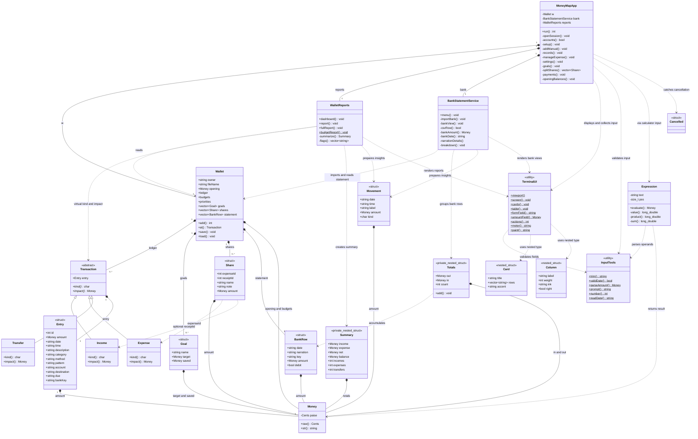

# MoneyMap — terminal expense tracker in C++

MoneyMap is a local, keyboard-driven personal-finance application. It records income, expenses, transfers and split bills, then calculates budgets, savings goals, category summaries and bank-statement insights. Data is kept in CSV files, so the application works offline and can be inspected or backed up easily.

## Features

- Multiple wallet accounts with an opening balance.
- Add income, expenses and transfers; edit or delete expenses.
- Category and payment-method tracking, including Must / Need / Want priorities.
- Split a bill between “Me” and other people; record repayments.
- Monthly and category budgets with utilization warnings.
- Savings goals and contributions.
- Import bank statements from CSV with duplicate detection.
- Dashboard, history, statistics and a full report.
- Calculator-style amount entry (for example `(120 + 80) / 2`).
- Color-coded terminal cards, tables, progress meters and responsive layout.

## Requirements

- Windows Terminal, PowerShell, or a UTF-8 capable terminal.
- A C++20 compiler such as MinGW-w64 `g++` (only needed when rebuilding).

## Run the supplied build

Open this folder in VS Code, open **Terminal → New Terminal**, then run:

```powershell
cd "D:\code\OOP_PROJECT\MoneyMap-OOP"
.\MoneyMap.exe
```

If your folder is elsewhere, use that folder in the `cd` command. Keep the executable in a writable folder because it creates account CSV files and a temporary `wallet.lock` file.

## Build from source

```powershell
g++ -std=c++20 -Wall -Wextra -Wpedantic -static `
  main.cpp application.cpp wallet.cpp bank.cpp reports.cpp `
  -o MoneyMap.exe
.\MoneyMap.exe
```

On a non-Windows shell, replace the final command with `./MoneyMap.exe` (or the name produced by your compiler).

## First use

1. Start the executable and choose or create an account.
2. Enter the owner name and opening balance.
3. Optionally set a monthly budget and savings goal.
4. Use the dashboard shortcuts:

| Key | Action |
|---|---|
| `N` | Add income, expense or transfer |
| `H` | Browse wallet history |
| `E` | Edit or delete an expense |
| `A` | Statistics for a month or all dates |
| `R` | Full financial report |
| `B` | Budgets and category priorities |
| `G` | Savings goals |
| `S` | Split a paid bill / record repayment |
| `I` | Import and analyse a bank CSV |
| `U` | Switch or create an account |
| `P` | Change opening balance |
| `Q` | Save and quit |

Press **Enter** at a screen’s return prompt to go back to the dashboard.

## How the program works

```text
main.cpp
  -> MoneyMapApp::run()
  -> load/select Wallet account
  -> TerminalUI draws dashboard and reads a shortcut
  -> MoneyMapApp routes the shortcut to a workflow
  -> Wallet mutates ledger/budgets/goals/shares/statement
  -> Wallet::save() writes the account CSV
  -> dashboard is rendered again
```

Reports read the wallet without changing it. Bank import reads an external CSV, converts each row to `BankRow`, rejects duplicate keys, and stores the statement rows in the wallet. Manual transactions are stored as polymorphic `Transaction` objects: `Income`, `Expense` and `Transfer`.

## Source map

| File | Main responsibility |
|---|---|
| `main.cpp` | Application entry point; creates `MoneyMapApp` and calls `run()`. |
| `application.hpp/.cpp` | Coordinates accounts, dashboard shortcuts and user workflows. |
| `wallet.hpp/.cpp` | Domain model, `Money`, `Entry`, `Transaction` hierarchy, CSV persistence and wallet-owned data. |
| `reports.hpp/.cpp` | Statistics, dashboard cards and full reports. |
| `bank.hpp/.cpp` | `BankStatementService`: CSV parsing, duplicate checks and payment-mode/merchant summaries. |
| `terminal.hpp` | `TerminalUI`: colors, cards, tables, prompts, meters and responsive terminal layout. |
| `common.hpp` | `InputTools`: validation, parsing, dates and shared prompts. |
| `calculator.hpp` | Expression parser and calculator input workflow. |
| `insights.hpp` | Movement records and reusable trend calculations. |

## OOP concepts used

- **Encapsulation:** `Wallet` controls ledger changes; `Money` hides its internal paise value.
- **Inheritance:** `Income`, `Expense` and `Transfer` derive from abstract `Transaction`.
- **Runtime polymorphism:** `Wallet` stores `unique_ptr<Transaction>` and reports call virtual `kind()` / `impact()` through the base type.
- **Composition:** `MoneyMapApp` owns service objects; `Wallet` owns transactions, goals, shares and bank rows.
- **Operator overloading:** `Money` supports arithmetic and comparisons.
- **STL and RAII:** `vector`, `map`, `unique_ptr`, algorithms and automatic resource cleanup.
- **File handling and exceptions:** CSV persistence/import plus validation using `try`, `catch` and `throw`.

## UML class diagram

This connected class diagram renders directly in GitHub. Boxes list representative members from the project headers. `+` means public, `-` means private, `*` marks an abstract operation and `$` marks a static operation. A filled diamond means composition, a hollow triangle points to the inherited base class, and a dotted arrow means a dependency.

This is a compact class view; method parameters and some members are omitted for readability. The file table above identifies each class's implementation.



**How to follow it:** `main.cpp` creates `MoneyMapApp` and calls `run()`. The application owns the active `Wallet` and both services. User actions modify the wallet or pass it to a reporting service. `TerminalUI` displays the resulting cards and tables.

**Runtime polymorphism:** the ledger stores `unique_ptr<Transaction>`. Calling `kind()` or `impact()` through a base pointer invokes the appropriate `Income`, `Expense` or `Transfer` implementation.

**Supporting types:** `Card` and `Column` are nested in `TerminalUI`; `Summary` is nested in `WalletReports`; `Totals` is nested in `BankStatementService`. `Expression` and `Cancelled` belong to the `calculator` namespace, while `Movement` belongs to `insights`. Namespace functions handle calculator cancellation and trend analysis; they are not additional classes.

**Storage:** the wallet's containers live in RAM during the session. `Wallet::save()` writes the selected account CSV; `load()` rebuilds its records. Imported bank rows remain separate from the manual ledger.

## Data and safety

The active account is saved as `wallet.csv`; account switching may create profile-specific CSV files. Bank CSV files are read but not modified. Back up your CSV files before experimenting with imported data. The included demo data is only sample data.

## Project verification

The package was tested for fresh-account setup, normal expense saving, split expenses, income, transfers, bank import, duplicate import and reopening saved data. Build with warnings enabled before submission so compiler diagnostics are visible during evaluation.
